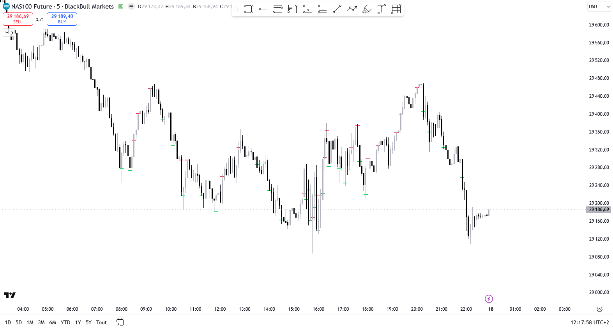
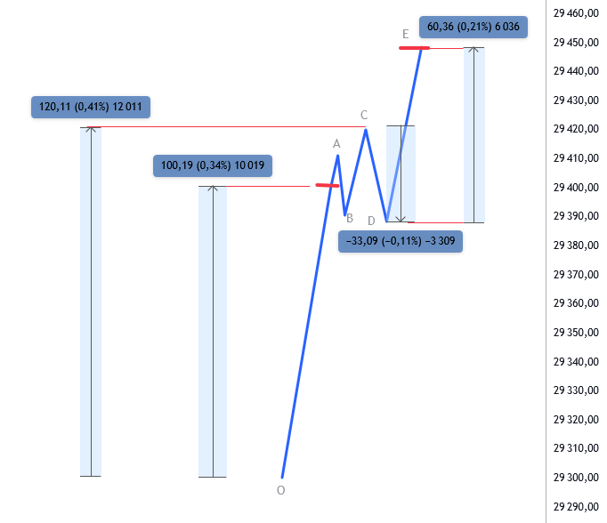

# JCO Amplitude — TradingView

Indicateur d'amplitude pour TradingView (Pine Script v6), orienté trading
**contrarien** sur futures indices (NQ / MNQ / ES / YM / RTY par défaut).
Port de l'indicateur Tradovate
[`Tradovate_Indicator_JCO_Amplitude`](https://github.com/jcornierfra/Tradovate_Indicator_JCO_Amplitude).

L'indicateur marque sur le graphique, par un trait horizontal au prix
exact, les instants où le marché s'est suffisamment éloigné du dernier
swing pour signaler une zone de retournement potentielle :

- **Mouvement BAS → HAUT** → marque **rouge** (signal vente contrarien)
- **Mouvement HAUT → BAS** → marque **verte** (signal achat contrarien)

## Résolution adaptative (depuis v2.2.0)

La version Tradovate travaille en tick. Sur TradingView, l'indicateur
adapte sa résolution de calcul à la timeframe du chart :

- **Chart ≥ M1** (M1, M5, M15, H1...) → calcul **forcé sur les bougies
  M1 sous-jacentes** via `request.security_lower_tf()`. C'est la
  référence universelle : le comportement et les marques sont identiques
  quelle que soit la TF d'affichage. Tu peux donc travailler sur un
  chart M15 pour le contexte tout en gardant la finesse de déclenchement
  M1 — les marques apparaissent aux **instants et prix exacts** du
  déclenchement M1 (donc parfois au milieu d'une bougie sur les TF > M1,
  c'est attendu et voulu).

- **Chart < M1** (15s, 30s — nécessite un abonnement TradingView qui
  débloque les sub-minute) → calcul **sur la TF du chart**, plus
  précis encore que la M1. Les seuils `Amp1` / `Amp2` ayant été
  calibrés pour la M1, à ajuster éventuellement à la baisse pour matcher
  la granularité plus fine (sinon davantage de marques, dont certaines
  bruitées).

> ⚠️ En realtime, Pine ré-exécute le script depuis l'état confirmé de la
> bougie chart précédente à chaque tick. Pour la bougie M1 (ou sub-minute)
> en cours de formation : maximum 1 marque par bougie en intra-bar.
> Acceptable sur les marchés visés ; sur une session normale on n'a
> jamais 2 marques dans la même minute.

## Mécanique

### Phase 1 — `searching` (1ère marque du jour)

Détection du dernier swing strict via `leftBars` / `rightBars`. Depuis
le swing trouvé, on attend qu'`amp1` soit atteint dans le sens opposé
(au-dessus si swing low, en dessous si swing high). Marque posée au
prix exact `swing.price ± amp1` → transition vers la phase 2.

### Phase 2 — `tracking` (cycles suivants)

Machine d'états par cycle (direction `up` ; symétrique en `down`) :

| État              | Rôle                                                                                                            |
|-------------------|-----------------------------------------------------------------------------------------------------------------|
| `origin`          | Ancre du calcul des 30 %                                                                                        |
| `refExtreme`      | Plus haut atteint depuis la marque (monotone)                                                                   |
| `oppExtreme`      | Plus bas atteint depuis la marque (monotone, ne reset PAS quand `refExtreme` monte). Sert au **continuation**   |
| `localOpp`        | Plus bas depuis le **dernier reset de `refExtreme`**. Reset à `refExtreme` sur nouveau plus haut. Sert au **reversal** |
| `recoveryExt`     | Plus haut atteint depuis le dernier reset de `oppExtreme`                                                       |
| `currentPath`     | `amp1` \| `amp2`, **sticky**, figé au moment où `oppExtreme` baisse                                             |
| `retracementSeen` | `true` dès qu'`oppExtreme` a strictement bougé sous la marque                                                   |

**Path** : réévalué **uniquement** quand `oppExtreme` baisse.
- `retrace = refExtreme - oppExtreme`
- `retrace > 30 % × (refExtreme - origin)` → `path = amp1`, sinon `path = amp2`

**Deux règles, évaluées à chaque tick, par priorité :**

1. **Reversal** (seuil = `amp1` toujours, requiert `retracementSeen`)
   - `localRetrace = refExtreme - localOpp ≥ amp1`
   - → marque `amp1`, **couleur opposée**, direction inversée
   - `origin ← refExtreme`

2. **Continuation** (path-driven)
   - `recovery = recoveryExt - oppExtreme ≥ amp_path`
   - → marque `amp_path`, **même couleur** que la précédente
   - `origin ← oppExtreme`

*Exemple : depuis le swing O, la 1ère marque est posée à `amp1` (≈100 pts). Le retracement C→D (−33) reste sous `amp1` : pas de reversal. La recovery D→E atteint `amp2` (≈60 pts) mesurée depuis `oppExtreme` (D) → marque de continuation, même couleur.*

### Reset journalier

À minuit (heure **Europe/Paris**) : oubli du swing actif et de la
dernière direction marquée, pour qu'après un gap éventuel la 1ère marque
du jour exige à nouveau `amp1`. Les marques déjà dessinées restent
visibles dans l'historique.

## Installation

1. Ouvrir TradingView → Pine Editor.
2. Coller le contenu de [`Indicator_JCO_Amplitude.pine`](Indicator_JCO_Amplitude.pine).
3. **Save** puis **Add to chart**.
4. **Toute timeframe** fonctionne. Sur chart ≥ M1, l'indicateur force la
   M1 en interne (référence). Sur chart < M1 (abonnement TradingView
   requis pour les sub-minute), il calcule sur la TF du chart pour un
   déclenchement encore plus précis. Voir
   [Résolution adaptative](#résolution-adaptative-depuis-v220).

## Paramètres

### Amplitudes
| Paramètre   | Défaut | Description                                                                |
|-------------|--------|----------------------------------------------------------------------------|
| `Amp1`      | 80     | Seuil de la 1ère marque du jour ET du reversal                             |
| `Amp2`      | 60     | Seuil de continuation (quand `currentPath = amp2`)                         |
| `pointSize` | 1.0    | Prix d'1 point : NQ / MNQ / ES / YM / RTY = 1. À ajuster pour d'autres contrats |

### Swing
| Paramètre   | Défaut | Description                                  |
|-------------|--------|----------------------------------------------|
| `leftBars`  | 1      | Nombre de bougies à gauche du pivot          |
| `rightBars` | 1      | Nombre de bougies à droite du pivot (la bougie en cours compte) |

### Fenêtre horaire (Europe/Paris)
| Paramètre               | Défaut | Description              |
|-------------------------|--------|--------------------------|
| `Début (Paris) h / min` | 08:00  | Début de la fenêtre      |
| `Fin   (Paris) h / min` | 22:00  | Fin de la fenêtre (exclu) |

### Affichage
| Paramètre         | Défaut    | Description                                     |
|-------------------|-----------|-------------------------------------------------|
| `markerWidthBars` | 1.4       | Largeur du trait (en multiples de bougie)       |
| `lineWidth`       | 2         | Épaisseur du trait                              |
| `bullColor`       | `#00C853` | Couleur haussière (signal achat contrarien)     |
| `bearColor`       | `#FF1744` | Couleur baissière (signal vente contrarien)     |

## Astuce d'affichage

Sur TradingView, les drawings d'un indicateur overlay peuvent passer
sous les chandeliers selon l'ordre de rendu. Si nécessaire :
**clic droit sur le nom de l'indicateur dans le chart → Visual order →
Bring to front**.

## Changelog

### v2.2.0 — 2026-05-17 (Pine)
- **TF forcée M1** quelle que soit la timeframe du chart via
  `request.security_lower_tf()`. Le chart peut être en M5, M15, H1... pour
  le contexte ; les marques restent calculées et placées au tick M1.
- État encapsulé dans un type `State` mutable (pour permettre la mutation
  depuis la fonction de traitement par bougie M1).
- Historique des bougies M1 maintenu dans des arrays locaux pour la
  détection swing (les offsets `[i]` ne sont plus pertinents avec
  l'itération par bougie M1).
- Marker width reste basé sur la TF du chart (pour rester visible sur
  les TF > M1).
- Limitation visuelle : sur une TF chart > M1, les marques apparaissent
  au timestamp M1 (au milieu des bougies du chart). C'est attendu et
  reflète l'instant exact du déclenchement.

### v2.1.3 — 2026-05-17 (Pine)
- Port initial Pine v6 de la version Tradovate v2.1.3.
- Adaptations TradingView :
  - Détection swing native via offsets de bars (`[i]`) sur la timeframe
    du chart (1 min recommandé) au lieu du tick-by-tick Tradovate.
  - Reset journalier basé sur `Europe/Paris` via une clé `year*10000 + month*100 + day`
    (Pine v6 n'expose pas `dayofyear()`).
  - Fenêtre horaire avec heures **et minutes** (alors que Tradovate n'avait
    que les heures).
  - Rendu via `line.new` (trait horizontal épaisseur paramétrable) au
    lieu du rectangle custom plotter de Tradovate, devenu inutile sur TV.

Pour le détail de la mécanique algorithmique (changelog Tradovate v1.0.0
à v2.1.3, qui décrit toutes les itérations sur les règles reversal /
continuation / path-evaluation), voir le
[changelog de la version Tradovate](https://github.com/jcornierfra/Tradovate_Indicator_JCO_Amplitude/blob/main/Indicator_JCO_Amplitude.js).

## Licence

[MPL-2.0](https://mozilla.org/MPL/2.0/) — © jcornier
